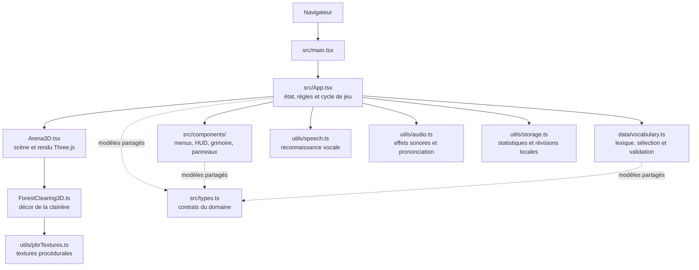

# LexiDeath

LexiDeath est un jeu d'action en 3D qui fait pratiquer le vocabulaire anglais dans une arène dark fantasy. Les zombies portent un mot français : il faut retrouver son équivalent anglais au clavier ou à la voix avant qu'ils atteignent le mage.

L'application fonctionne dans le navigateur. La progression et les mots à réviser sont conservés localement sur l'appareil ; aucun compte ni serveur applicatif n'est requis.

## Fonctionnalités

- Arène 3D isométrique construite avec Three.js : clairière, mage, zombies, éclairages, brume et effets de sort.
- Trois modes de réponse : clavier, reconnaissance vocale ou mode hybride.
- Ciblage automatique à partir des premières lettres saisies ; les réponses vocales peuvent verrouiller une cible ou éliminer un zombie.
- Vagues de difficulté croissante : 15 ennemis à la première vague, puis 3 de plus par vague jusqu'à un maximum de 25. Les mots des vagues doivent tous être éliminés pour avancer.
- Trois archétypes d'ennemis (standard, rapide et boss), avec des vitesses, points et résistances différents.
- Cinq vies, score, précision, séries de bonnes réponses et multiplicateur de score.
- Grimoire consultable, filtrable et recherchable, avec prononciation audio des mots.
- Révision espacée des mots manqués et affichage temporaire du dernier mot raté, accompagné de sa traduction.
- Sauvegarde locale des statistiques et des mots à revoir.
- Interface responsive, notamment pour les petits écrans et l'ouverture du clavier virtuel.

La banque contient actuellement **211 mots et expressions** répartis entre vocabulaire quotidien, travail, voyage, médical, dark fantasy et phrases. Elle se trouve dans [`src/data/vocabulary.ts`](src/data/vocabulary.ts).

## Architecture



Pour les responsabilités des modules et les principaux flux de données, consulter [`docs/ARCHITECTURE.md`](docs/ARCHITECTURE.md).

## Prérequis

- Node.js 20.19 ou supérieur, ou 22.12 ou supérieur (versions compatibles avec le plugin Vite React verrouillé par le projet).
- npm (fourni avec Node.js), ou Bun si vous préférez le gestionnaire dont le fichier de verrouillage est aussi présent.
- Un navigateur récent avec WebGL pour la scène 3D.
- Pour le mode vocal : un navigateur prenant en charge la Web Speech API et l'accès au microphone. Les permissions du navigateur sont nécessaires ; la reconnaissance vocale dépend du navigateur et de sa plateforme. En production, utilisez un contexte sécurisé HTTPS.

## Installation et lancement

```bash
npm ci
npm run dev
```

Vite démarre le serveur de développement sur le port `3000` (modifiable par la configuration Vite). Ouvrez l'URL affichée dans le terminal.

Avec Bun, utilisez `bun install --frozen-lockfile` à la place de `npm ci`, puis lancez `bun run dev`.

## Commandes

| Commande | Rôle |
| --- | --- |
| `npm run dev` | Lance le serveur de développement Vite. |
| `npm run lint` | Vérifie les types TypeScript avec `tsc --noEmit`. |
| `npm run build` | Construit l'application statique dans `dist/` avec Vite. |
| `npm run preview` | Sert localement la dernière version construite. |
| `npm run clean` | Supprime `dist/` et `server.js` (la commande actuelle utilise `rm -rf`, donc un shell compatible POSIX est requis). |

Il n'y a pas encore de suite de tests automatisés dédiée. `lint` effectue le contrôle TypeScript ; `build` ne lance pas ce contrôle séparément.

## Comment jouer

1. Choisir le mode d'entrée dans le menu puis lancer une partie.
2. Lire le mot français porté par un zombie et saisir ou prononcer son équivalent anglais.
3. Au clavier, le début d'une réponse verrouille automatiquement la cible correspondante ; terminer le mot permet de l'éliminer.
4. En mode vocal, autoriser le microphone et prononcer le mot anglais. Selon le navigateur, la reconnaissance peut nécessiter une interaction ou une connexion réseau.
5. Un zombie qui atteint le centre attaque et fait perdre une vie. Il est repoussé vers le bord de l'arène et reste à éliminer pour terminer la vague.
6. Ouvrir le Grimoire pour consulter les traductions, rechercher un terme et réviser les mots précédemment manqués.

Une réponse acceptée peut être le terme principal ou l'une de ses variantes déclarées dans la banque. Les comparaisons ignorent la casse, les accents et la ponctuation. La synthèse vocale utilise les voix disponibles dans le navigateur et prononce les mots en anglais américain lorsqu'elle est prise en charge.

## Données et configuration

- `src/data/vocabulary.ts` contient les mots, traductions, catégories, niveaux de difficulté, indications phonétiques et variantes acceptées.
- `src/utils/storage.ts` conserve les statistiques et les mots à revoir dans `localStorage`. Effacer les données du site efface aussi cette progression.
- `src/utils/speech.ts` encapsule la reconnaissance vocale native du navigateur.
- `src/utils/audio.ts` produit les effets sonores avec Web Audio et utilise la synthèse vocale du navigateur.
- `src/utils/useVisualViewport.ts` adapte l'affichage aux changements de viewport, d'orientation et au clavier virtuel.

Le jeu n'effectue actuellement aucun appel à l'API Gemini et ne nécessite pas de clé API. `.env.example` est conservé comme exemple issu de l'environnement de génération, mais sa variable n'est pas lue par l'application. Ne placez jamais une clé secrète dans une variable `VITE_*` ou dans du code livré au navigateur.

## Hébergement

`npm run build` produit un site statique dans `dist/`, hébergeable sur un service compatible avec les applications Vite. Le dépôt GitHub sert au versionnement du code ; la publication des sources sur GitHub ne configure pas à elle seule un hébergement et aucun déploiement GitHub Pages n'est activé par ce projet.
