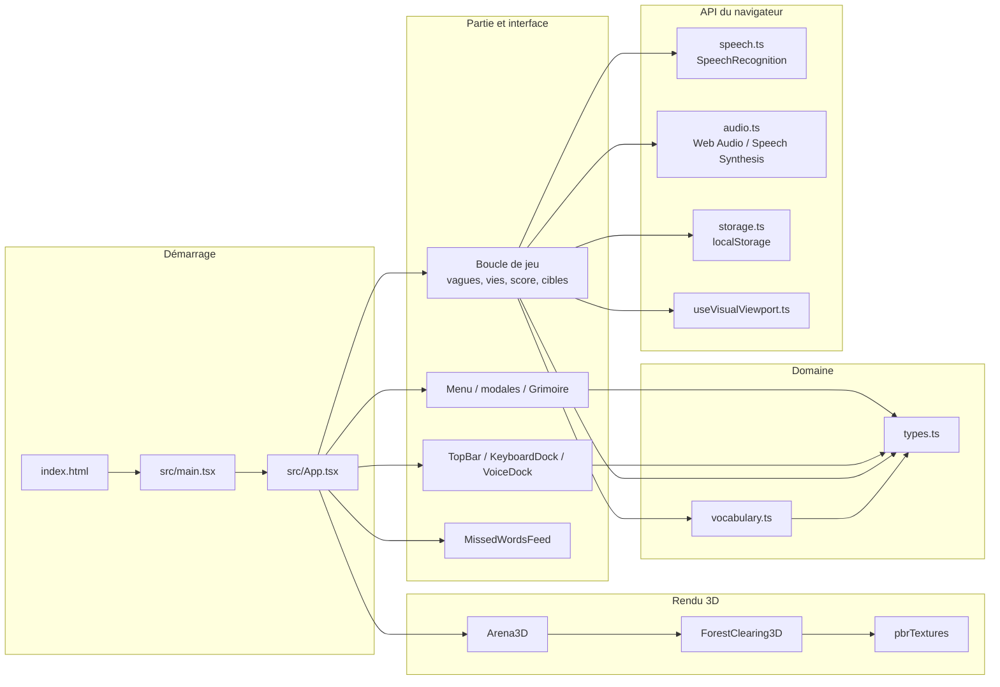
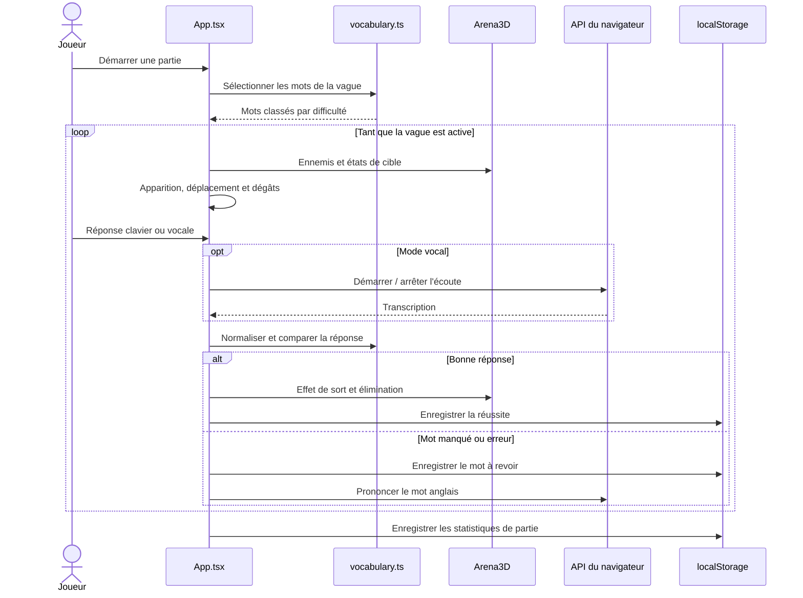

# Architecture de LexiDeath

LexiDeath est une application React côté navigateur. `App.tsx` orchestre la partie et relie le rendu 3D, les entrées clavier/voix, le lexique et la progression persistée localement. Les composants visuels reçoivent des données et des callbacks ; les règles de partie et l'accès aux utilitaires sont centralisés dans l'orchestrateur.

## Vue des modules

## Responsabilités

| Module | Responsabilité |
| --- | --- |
| `src/main.tsx` | Monte React dans l'élément `#root` et active `StrictMode` en développement. |
| `src/App.tsx` | Gère les écrans, l'état de partie, l'apparition et le déplacement des ennemis, les entrées, la résolution des réponses, les dégâts, la progression des vagues et la persistance. |
| `src/types.ts` | Définit les contrats partagés : entrées du lexique, états d'ennemi, modes de saisie, statistiques et enregistrements de révision. |
| `src/data/vocabulary.ts` | Déclare le lexique et fournit sélection de mots par vague, normalisation des réponses et validation exacte des variantes admises. |
| `src/components/Arena3D.tsx` | Crée et anime la scène Three.js, la caméra, les personnages, les cibles et les effets visuels. |
| `src/components/ForestClearing3D.ts` | Construit le décor procédural de la clairière et expose les éléments animés comme les lucioles et lumières de champignons. |
| `src/components/CastleCourtyard3D.ts` | Contient un constructeur alternatif de cour de château ; la scène courante utilise la clairière via `Arena3D`. |
| `src/utils/pbrTextures.ts` | Génère des textures procédurales et leurs cartes de matériau pour le décor 3D. |
| `src/components/` | Regroupe les composants React de l'interface : menu, HUD, entrées, grimoire et modales de progression. |
| `src/utils/speech.ts` | Encapsule la reconnaissance vocale du navigateur, les résultats et les erreurs de compatibilité. |
| `src/utils/audio.ts` | Synthétise les effets sonores et prononce les mots à l'aide des API Web Audio et Speech Synthesis. |
| `src/utils/storage.ts` | Lit et écrit les statistiques de jeu ainsi que les mots manqués à réviser dans `localStorage`. |
| `src/utils/useVisualViewport.ts` | Observe le viewport visuel pour s'adapter au redimensionnement, à l'orientation et au clavier mobile. |

## Flux d'une partie

## Modèle de partie

- L'état React visible est complété par des références (`useRef`) pour la file de vague et les compteurs consultés par les intervalles. Cela évite notamment les effets de bord dans les callbacks d'updaters d'état invoqués plusieurs fois par `StrictMode`.
- Une vague contient 15 ennemis au départ, croît de 3 par vague et est plafonnée à 25. Le nombre de mots du lexique permet de compléter les vagues sans réutiliser un mot dans la même sélection.
- Le type d'ennemi découle de la difficulté du mot : niveau 1 standard, niveau 2 rapide, niveau 3 boss. Le boss possède deux points de vie.
- Un ennemi arrivé au centre attaque puis est repoussé ; il n'est pas supprimé. La vague n'est terminée qu'après élimination de tous ses mots et disparition de toutes les menaces actives.
- Les mots ratés sont réinjectés en priorité dans les sélections futures. Le Grimoire lit la même banque que le jeu et associe les enregistrements de révision aux entrées par identifiant.
- Le feed d'apprentissage n'affiche qu'un seul mot manqué à la fois. Une nouvelle notification remplace l'ancienne et s'efface après son délai de visibilité.

## Limites d'exécution

- La scène nécessite WebGL et réduit le ratio de pixels ainsi que la résolution des ombres sur les écrans mobiles.
- La reconnaissance vocale est fournie par le navigateur, pas par un service hébergé par le projet ; disponibilité, permission et qualité de transcription varient selon l'environnement.
- La synthèse vocale choisit une voix anglaise installée si elle est disponible et utilise sinon la voix par défaut du navigateur.
- La sauvegarde est locale à l'origine et au profil de navigateur courants. Elle n'est ni synchronisée ni sauvegardée sur un serveur.
- La variable `GEMINI_API_KEY` présente dans `.env.example` n'est pas consommée par le code applicatif actuel.
